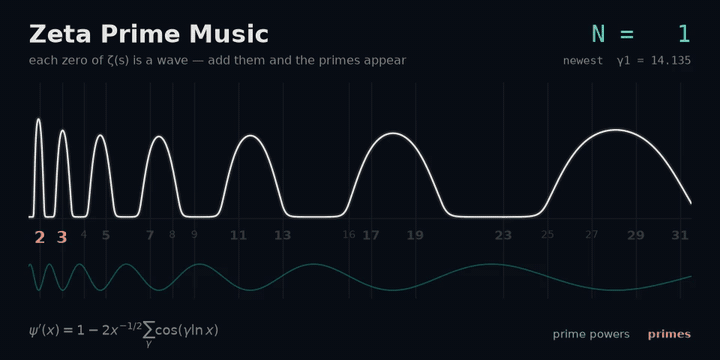

<div align="center">

<h1>Zeta Prime Music</h1>

<p><b>Nobody wrote this music. It was hiding in the prime numbers.</b></p>

<a href="https://joe-carr-data.github.io/zeta-prime-music/#listen"></a>

<p>
<a href="https://joe-carr-data.github.io/zeta-prime-music/#listen"></a>
<a href="https://joe-carr-data.github.io/zeta-prime-music/demo.html"></a>
<a href="docs/FOR_MUSICIANS.md"></a>
</p>

<p>
<a href="https://github.com/joe-carr-data/zeta-prime-music/actions/workflows/ci.yml"></a>

<a href="LICENSE"></a>
<a href="LICENSE-MEDIA.md"></a>
</p>

</div>

2, 3, 5, 7, 11, 13… The primes look random: no simple rule tells you where the next one falls. In 1859
Bernhard Riemann found that they are governed by a hidden set of numbers, the zeros of the zeta function,
and that **each zero is a wave**. Play those waves together and wrong notes drift and wobble, then lock onto
the primes one by one, until the whole number line is in tune.

**Every note, rhythm and accent here comes from the mathematics. No one composed a single one; we only chose
the instruments.**

> [!NOTE]
> **Why now.** A proof of the Riemann Hypothesis was announced in November 2026: Levent Alpöge released a
> claimed proof, with a formal version checked in Lean, and mathematicians are now examining it. The zeros you
> hear have long been computed to lie on Riemann's critical line; if the proof holds, all infinitely many do.

<table>
<tr>
<td width="25%" align="center"><a href="https://joe-carr-data.github.io/zeta-prime-music/#listen"><b>▶ Listen</b></a><br><sub><i>The Sound of the Primes</i>, 2:56: piano, vibraphone, bass and drums play only what the zeros dictate</sub></td>
<td width="25%" align="center"><a href="https://joe-carr-data.github.io/zeta-prime-music/demo.html"><b>🎛 Play</b></a><br><sub>A web instrument: slide from 1 to 200 zeros and hear the primes come into tune</sub></td>
<td width="25%" align="center"><a href="docs/FOR_MUSICIANS.md"><b>🎼 Read</b></a><br><sub>How every pitch, rhythm and dynamic follows from the explicit formula</sub></td>
<td width="25%" align="center"><a href="#quick-start"><b>⌨ Build</b></a><br><sub>Regenerate every track, MIDI file and video from a clean clone</sub></td>
</tr>
</table>

## How it works

Each nontrivial zero ρ = ½ + iγ adds one oscillation x<sup>−1/2</sup> cos(γ ln x) to Riemann's explicit formula
for the primes:

```
ψ′(x) = 1 − 2x^(−1/2) Σ_γ cos(γ ln x) − 1/(x(x²−1))
```

Add enough of them and the sum spikes at 2, 3, 5, 7, 11… with smaller "overtones" at 4, 8, 9, 16 (the prime
powers). This repo turns that interference pattern into music:

| In the maths | In the music |
|---|---|
| a zero γ | a drone partial at a frequency proportional to γ |
| a spike at a prime p | a plucked note at the p-th harmonic of G, folded into range |
| a spike at a prime power p<sup>k</sup> | a bell, 1/k as loud |
| a peak not yet on an integer | an off-key "ghost" note |
| more zeros | sharper spikes: the ghosts lock onto the primes |

<details>
<summary><b>The pieces</b></summary>

- ***The Sound of the Primes*** (radio edit, 2:56, 112.5 BPM in 5/4): the produced version, score
  `compositions/commercial/critical_strip_radio_kontakt.toml`.
- ***Critical Strip*** (3:28) and ***Critical Strip (revised)*** (3:12): the original concept pieces in exact
  microtonal tuning, where every note audibly bends into place (`compositions/`).

</details>

Inspired by [*From First Principles* ep. 69](https://www.youtube.com/watch?v=zSGBxRjzyb8), where the first 200
zeros are added and spikes appear at the primes ([docs/VIDEO_ANALYSIS.md](docs/VIDEO_ANALYSIS.md)).

## Quick start

```bash
uv sync                      # Python ≥ 3.12
make render                  # → output/critical_strip.{wav,mid,events.json,score.png}
make proposals               # → output/proposals/A–E (.wav + .m4a)
make video clips             # visualiser video + five vertical clips (needs ffmpeg)
make web                     # interactive demo → output/web/hear-the-primes.html
make explain                 # figure reproducing the video's argument
make hero                    # README animation → docs/media/hero.gif (needs ffmpeg)
make produce                 # radio edit → output/commercial (needs fluidsynth + a GM SoundFont)
make all                     # everything above from a clean clone, after lint + tests
make test lint
```

CLI (after `uv sync`; plots and video need the `plot` extra — `uv sync --extra plot` or
`pip install '.[plot]'` — and video needs ffmpeg on PATH):

```bash
uv run zeta-music render compositions/critical_strip.toml -o output
uv run zeta-music literal log -n 200 -d 10 -o output/zeros_chord.wav
uv run zeta-music literal linear -n 200 -d 10 -o output/prime_clicks.wav
uv run zeta-music explain -n 200 --xmax 30
uv run zeta-music video compositions/critical_strip.toml --audio output/critical_strip.wav --aspect 9:16 --start 16 --end 64
uv run zeta-music zeros 10
uv run --extra produce zeta-music produce compositions/commercial/critical_strip_radio.toml --soundfont GeneralUser-GS.sf2
uv run --extra produce zeta-music produce-preset --plugin /Library/Audio/Plug-Ins/VST3/X.vst3 --out x.state
```

## Layout

```
src/zeta_music/
  zeros.py        first 500 zeros bundled (mpmath), more computed + cached on demand
  explicit.py     ψ(x), ψ'(x) explicit formulas, prime powers, von Mangoldt, spectral tapers
  composition.py  timeline → salience curve → note events → drone/plucks/bells/breath → mix
  produce.py      produced version: tempo map, just/tempered MIDI, SoundFont/plugin instruments, mix, master
  synth.py        Karplus–Strong, FM bell, convolution reverb, mastering
  midi.py         MIDI export with microtonal pitch bend
  literal.py      direct sonification of the sums
  plots.py        explainer figure + graphic score
  config.py       typed TOML score format
compositions/     scores (TOML)
docs/             video analysis, composition notes, research prompt, progress/backlog
tests/            pytest suite (math is tested against known values)
```

## Writing your own piece

A score is a list of sections, each sweeping the number line `x` while a number of zeros is
switched on. See [compositions/critical_strip.toml](compositions/critical_strip.toml) and
[docs/COMPOSITION.md](docs/COMPOSITION.md) for every mapping and its mathematical justification.

## Licence

Code: [MIT](LICENSE). Music, video, animation and figures: [CC BY 4.0](LICENSE-MEDIA.md) —
credit "Zeta Prime Music" by Joe Carr.
